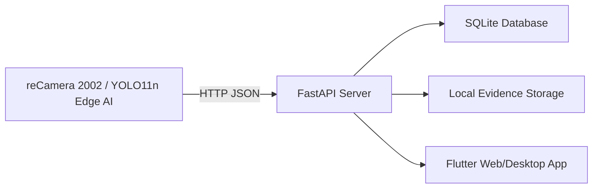

# PPE Guard

**AI-Powered PPE Compliance Monitoring System using reCamera, FastAPI, SQLite, and Flutter**

PPE Guard is a computer engineering project designed to verify Personal Protective Equipment before a worker enters a work area. AI inference runs locally on a reCamera edge device, while inspection results and evidence are managed by an on-premise server and monitoring application.

## PPE Detection

The system detects one person and five required PPE items:

- Safety helmet
- Safety glasses
- Safety gloves
- Safety shoes
- Safety vest

A session is marked **SAFE** only when all required PPE items are detected. Otherwise, it is recorded as **NOT SAFE**.

## Project Presentation

ชมวิดีโอแนะนำโครงงาน PPE Guard ระบบตรวจสอบอุปกรณ์ป้องกันส่วนบุคคลด้วย AI

[▶️ เปิดดูวิดีโอแนะนำโครงงาน](https://youtu.be/9n46qjDT2T8)

## System Architecture

